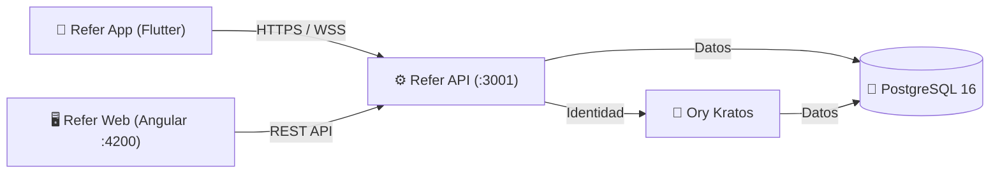
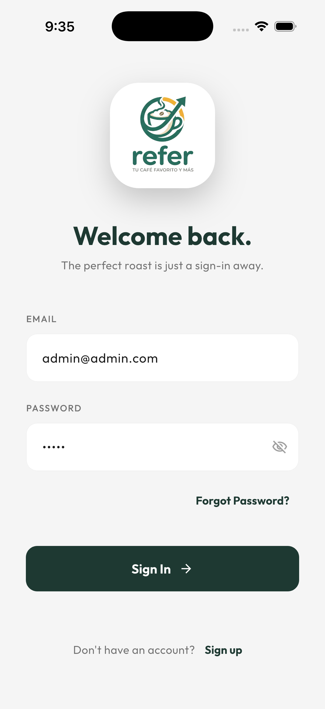
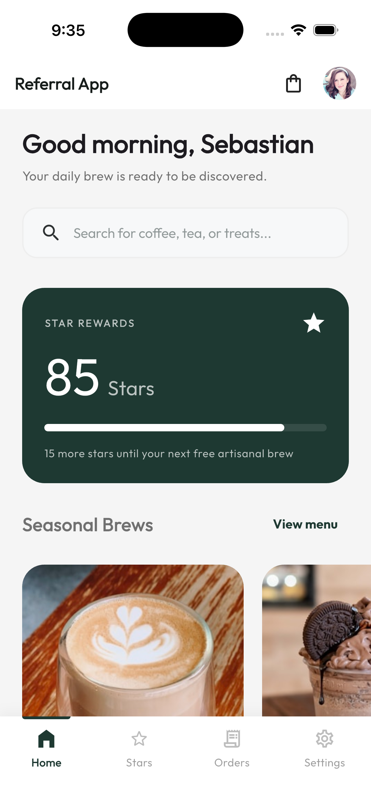
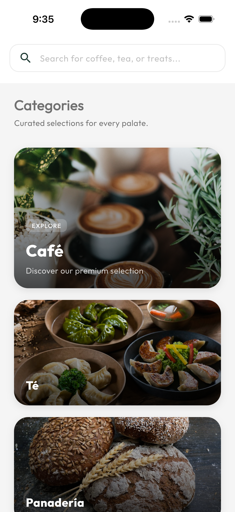
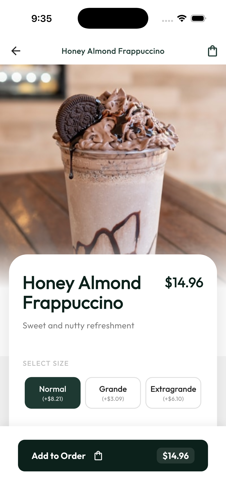
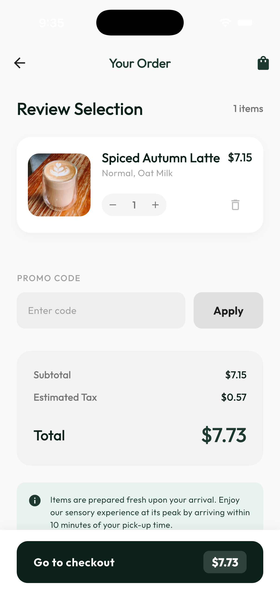
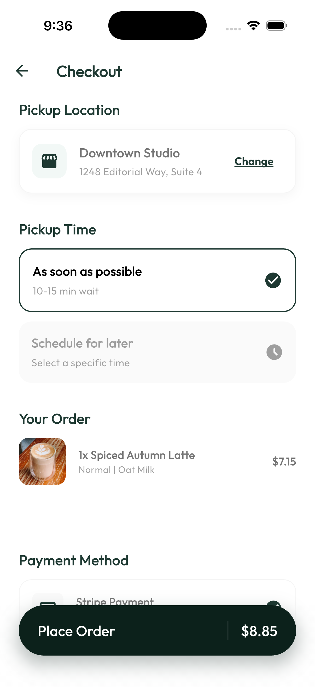

<div align="center">

# 🛍️ ABAL-COMMERCE

**Plataforma integral de comercio electrónico lista para producción**  
Backend API · Panel de Administración Web · Aplicación Móvil (iOS & Android)

[](https://docs.docker.com/compose/)
[](https://www.postgresql.org/)
[](https://www.ory.sh/kratos/)
[](https://angular.dev/)
[](https://flutter.dev/)
[](https://stripe.com/)

</div>

---

## 📋 Descripción General

**ABAL-COMMERCE** es una solución completa de e-commerce diseñada para desplegarse rápidamente mediante **Docker Compose** (sin necesidad de compilar código fuente para backend y web) junto con una aplicación móvil nativa en **Flutter**.

El ecosistema se compone de tres módulos principales:

| Módulo | Tecnología | Descripción | Puerto por defecto | Guía |
| :--- | :--- | :--- | :---: | :--- |
| **`backend/`** | Refer API · PostgreSQL 16 · Ory Kratos | API REST, WebSockets, gestión de identidad y base de datos | `3001` | [Ver guía](backend/README.md) |
| **`frontend/`** | Angular (Refer Web) | Panel de administración web | `4200` | [Ver guía](frontend/README.md) |
| **`mobile/`** | Flutter (iOS & Android) | App de clientes con catálogo, Stripe, Stars y pedidos en vivo | — | [Ver guía](mobile/README.md) |

---

## 🏗️ Arquitectura



---

## 📁 Estructura del Repositorio

```text
ABAL-COMMERCE/
├── backend/                  # Stack de Refer API (Docker Compose)
│   ├── docker-compose.yml    # Servicios: postgres, kratos-migrate, kratos, app
│   ├── init-db.sql           # Inicialización de bases de datos (refer y kratos)
│   ├── kratos/               # Configuración y esquema de identidad de Ory Kratos
│   ├── .env.example          # Plantilla de variables de entorno del backend
│   └── README.md             # Guía detallada de despliegue del backend
├── frontend/                 # Stack de Refer Web (Docker Compose)
│   ├── docker-compose.yml    # Servicio web (panel de administración Angular)
│   ├── .env.example          # Plantilla de variables de entorno del frontend
│   └── README.md             # Guía detallada de despliegue del frontend
├── mobile/                   # Documentación y capturas de Refer App (Flutter)
│   ├── images/               # Capturas de pantalla de la aplicación móvil
│   └── README.md             # Funcionalidades y solicitud de APK / AAB / IPA
└── README.md                 # Documentación general del proyecto
```

---

## 🚀 Inicio Rápido

### Requisitos Previos
- **Docker Engine** y **Docker Compose v2** (`docker compose`)
- **`openssl`** (para generar secretos criptográficos del backend)

---

### 1. Desplegar el Backend (`backend/`)

```bash
cd backend
cp .env.example .env
```

Genera los secretos obligatorios en `.env`:

```bash
sed -i.bak \
  -e "s|^DB_PASSWORD=.*|DB_PASSWORD=$(openssl rand -hex 16)|" \
  -e "s|^AUTH_JWT_SECRET=.*|AUTH_JWT_SECRET=$(openssl rand -base64 48 | tr -d '\n')|" \
  -e "s|^KRATOS_SECRETS_CIPHER=.*|KRATOS_SECRETS_CIPHER=$(openssl rand -hex 16)|" \
  -e "s|^KRATOS_SECRETS_COOKIE=.*|KRATOS_SECRETS_COOKIE=$(openssl rand -hex 32)|" \
  .env && rm -f .env.bak
```

> Edita `backend/.env` si necesitas configurar `STRIPE_SECRET_KEY`, `CORS_ORIGINS`, `KRATOS_SMTP_URI` (o `SIGNUP_EMAIL_ENABLED=false`) y `ADMIN_PASSWORD`.

Levanta los servicios:

```bash
docker compose up -d
```

Verifica el estado:

```bash
docker compose ps
curl http://localhost:3001/health
```

---

### 2. Desplegar el Panel Web (`frontend/`)

```bash
cd ../frontend
cp .env.example .env
```

Ajusta en `frontend/.env` las URLs según tu entorno (`APP_BACKEND_URL`, `APP_BASE_URL`, `HOST_PORT`) y asegúrate de incluir el dominio del frontend en `CORS_ORIGINS` dentro de `backend/.env`.

Levanta el servicio web:

```bash
docker compose up -d
```

Verifica el estado:

```bash
docker compose ps
curl http://localhost:4200/health
```

---

### 3. Aplicación Móvil (`mobile/`)

La app móvil (**Refer App**) incluye:
- Autenticación clásica y social (**Google** / **Apple**)
- Catálogo por categorías con personalización de opciones (tamaños, variantes, extras)
- Sistema de recompensas (**Stars**)
- Seguimiento de pedidos en tiempo real vía **Socket.IO**
- Pagos integrados con **Stripe** y **Apple Pay**
- Soporte multi-idioma (**Español** e **Inglés**)

<div align="center">
  
  
  
  <br/><br/>
  
  
  
</div>

> Debido a que la configuración del servidor y llaves públicas se compilan y ofuscan en el binario, los compilados personalizados (**APK / AAB / IPA**) se solicitan por correo a [`hola@abal.cobyzero.com`](mailto:hola@abal.cobyzero.com). Consulta todos los requisitos en [mobile/README.md](mobile/README.md).

---

## 🛠️ Comandos Útiles

Ejecutar dentro de `backend/` o `frontend/`:

| Acción | Comando |
| :--- | :--- |
| Ver estado de contenedores | `docker compose ps` |
| Ver logs en tiempo real | `docker compose logs -f` |
| Detener servicios | `docker compose down` |
| Detener y eliminar volúmenes *(solo backend, borra la BD)* | `docker compose down -v` |
