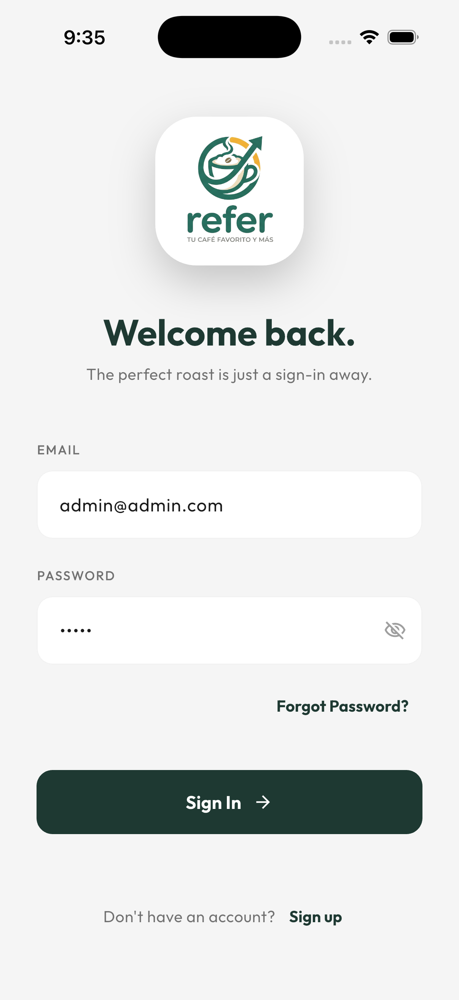
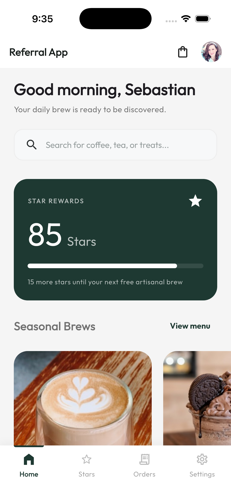
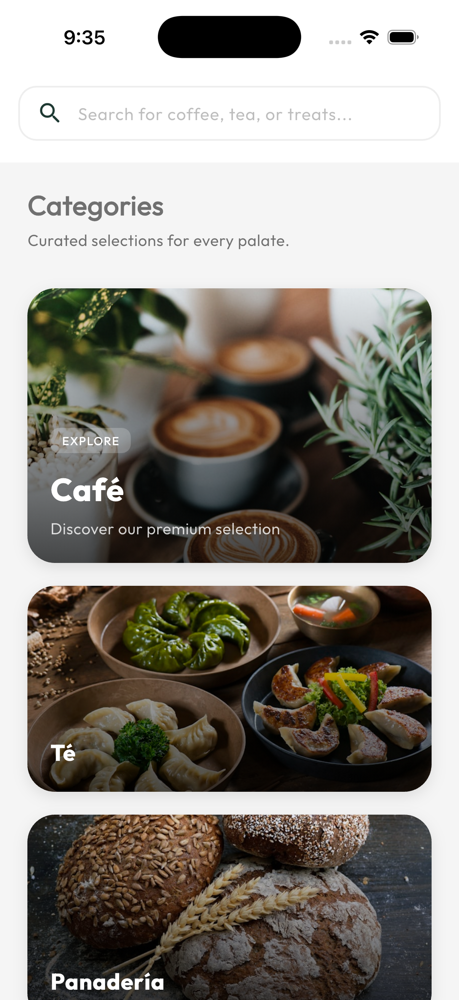
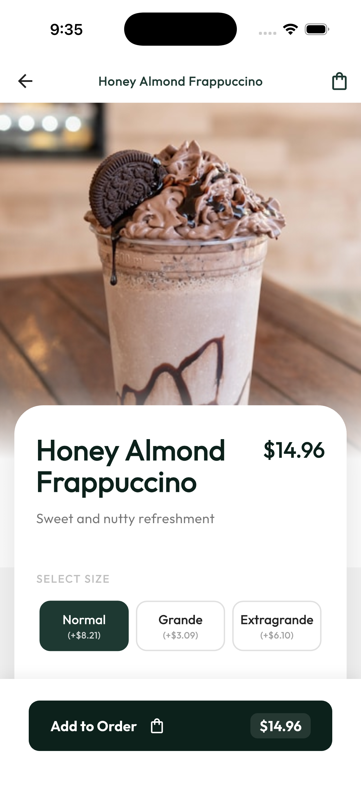
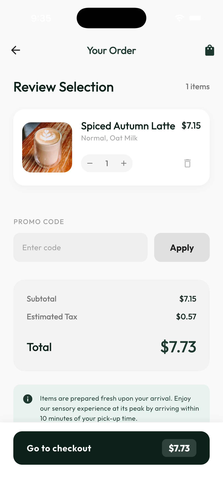
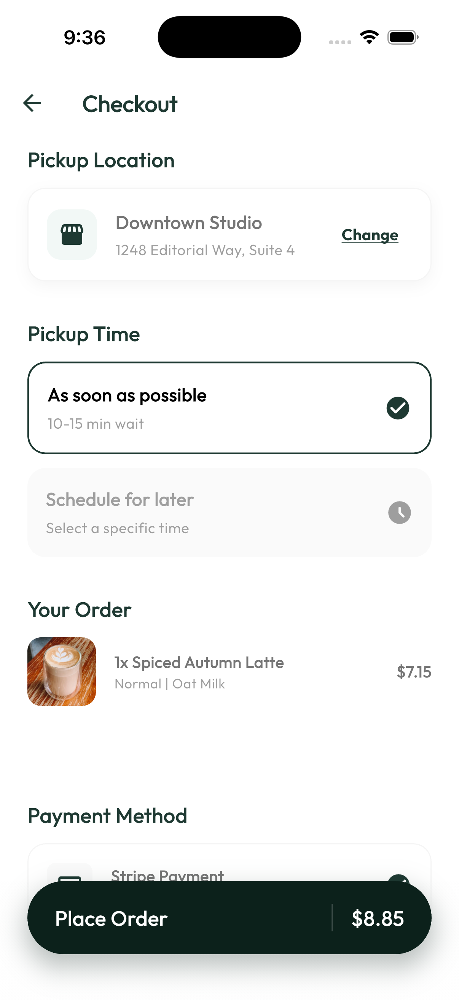

# Refer App — Aplicación Móvil (iOS y Android)

Esta carpeta documenta la aplicación móvil de **ABAL-COMMERCE** (**Refer App**), desarrollada en **Flutter** para **iOS** y **Android**.

> **Nota:** Este repositorio de distribución no incluye código fuente ni binarios genéricos. Debido a que la URL del servidor, las llaves públicas de pago y los identificadores de la app se compilan y ofuscan directamente dentro del binario, cada **APK / AAB / IPA** se genera de forma personalizada para tu entorno.

---

## Capturas de Pantalla

  
  
  
    
  
  
  

---

## Qué incluye la aplicación

- **Autenticación segura**: Registro e inicio de sesión clásico y social (Google / Apple).
- **Catálogo y personalización**: Exploración de productos por categoría con configuración detallada de opciones (tamaño, variantes, extras, etc.).
- **Sistema de recompensas (Stars)**: Acumulación de estrellas por compra y canje por beneficios o productos.
- **Pedidos en tiempo real**: Seguimiento del estado del pedido en vivo mediante WebSockets (Socket.IO) e historial de órdenes.
- **Pagos integrados**: Checkout y procesamiento de pagos con **Stripe** (incluyendo soporte para Apple Pay).
- **Multi-idioma**: Soporte completo en Español e Inglés.
- **Arquitectura moderna**: Flutter + BLoC, navegación con GoRouter, almacenamiento seguro de sesión y configuración sensible ofuscada en tiempo de compilación.

---

## Cómo solicitar tu APK o IPA personalizado

Para recibir el compilado (**APK / AAB** para Android y/o **IPA** para iOS) apuntando a tu propio servidor, escríbenos a:

**Correo:** [`hola@abal.cobyzero.com`](mailto:hola@abal.cobyzero.com)

Incluye en el mensaje la siguiente información:

1. **URL de tu servidor (Backend API):** URL pública con HTTPS donde desplegaste `backend/` (ej. `https://api.tudominio.com`).
2. **Plataforma(s) solicitada(s):** Android (`.apk` para pruebas/instalación directa o `.aab` para Google Play) y/o iOS (`.ipa`).
3. **Configuración de Stripe:** Tu `STRIPE_PUBLISHABLE_KEY` (`pk_live_...` o `pk_test_...`) y, si usas Apple Pay, tu `STRIPE_MERCHANT_IDENTIFIER`.
4. **URLs legales:** Enlaces públicos a tus **Términos del Servicio** y **Política de Privacidad**.
5. **Datos de publicación (opcional):** Nombre de la app, identificador (`applicationId` / `bundleId`) o logo si requieres branding personalizado.
